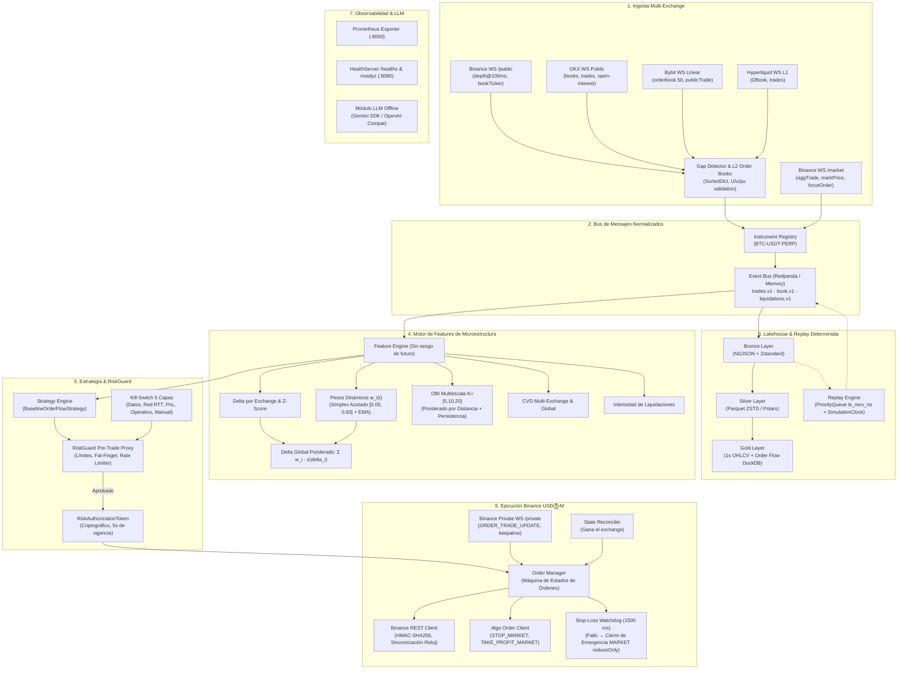

# Orderflow Bot: Sistema Institucional de Trading Cuantitativo de Microestructura

Sistema de alta disponibilidad, baja latencia y reproducibilidad matemática para trading cuantitativo basado en microestructura de mercado y flujo de órdenes (*order flow*) en cripto-derivados.

El proyecto abarca el ciclo completo de vida del trading algorítmico: desde la **ingesta en tiempo real de 4 exchanges** (**Binance USDⓈ-M Futures**, **OKX**, **Bybit**, **Hyperliquid**), normalización de eventos y persistencia en un **Lakehouse local/S3** (Bronze, Silver, Gold), hasta un **motor de features unificado** (Delta Global ponderado, OBI multiescala, CVD, liqders y reconciliación periódica.
uidaciones), control pre-trade ineludible con **RiskGuard**, **Kill-Switch defensivo de 5 capas**, y ejecución institucional en **Binance USDⓈ-M Futures** con soporte de Algo Or
---

## Tabla de Contenidos
1. [¿Qué es este proyecto?](#1-qué-es-este-proyecto)
2. [Stack Tecnológico y Justificación](#2-stack-tecnológico-y-justificación)
3. [Arquitectura del Sistema](#3-arquitectura-del-sistema)
4. [Cómo se Conecta con Binance Futures](#4-cómo-se-conecta-con-binance-futures)
5. [Gestión de Riesgo y Kill-Switch de 5 Capas](#5-gestión-de-riesgo-y-kill-switch-de-5-capas)
6. [Cómo se Ejecuta el Bot](#6-cómo-se-ejecuta-el-bot)
7. [Cómo Realizar las Pruebas (Tests y Calidad)](#7-cómo-realizar-las-pruebas-tests-y-calidad)
8. [Documentación Clave del Proyecto](#8-documentación-clave-del-proyecto)
9. [Estructura del Repositorio](#9-estructura-del-repositorio)
10. [Estrategia Explicada de Forma Sencilla: ¿Cómo Decide el Bot?](#10-estrategia-explicada-de-forma-sencilla-cómo-decide-el-bot)
11. [¿Para qué sirve el Módulo LLM si todo está en Código?](#11-para-qué-sirve-el-módulo-llm-si-todo-está-en-código)

---

## 1. ¿Qué es este proyecto?

Este bot está diseñado bajo una filosofía de ingeniería escéptica y cuantitativa: **la preservación del capital, la corrección operativa y la reproducibilidad matemática prevalecen sobre promesas de rentabilidad o micro-optimizaciones prematuras de latencia**.

### Capacidades Principales
- **Ingesta Multi-Exchange en Tiempo Real**:
  - **Binance USDⓈ-M Futures**: Datos de mercado (`depth@100ms`, `aggTrade`, `markPrice`, `forceOrder`) + ejecución privada (`/private` WS).
  - **OKX**: Feeds públicos de libros L2, trades, tasas de financiación e interés abierto (con conversión de multiplicadores de contratos, ej. 0.01 BTC/contrato).
  - **Bybit**: Feeds de perpétuos lineales (orderbook.50, public trades, tickers).
  - **Hyperliquid**: Feed WebSocket directo sobre su Layer 1 nativa (L1) con loop de ping supervisor de 45 segundos.
- **Lakehouse Local / S3 y Replay Determinista**:
  - **Bronze**: Streaming continuo en NDJSON comprimido con Zstandard (`zstd`).
  - **Silver**: Tablas tipadas Parquet generadas mediante Polars y Apache Arrow.
  - **Gold**: Agregación analítica de barras de microestructura de 1 segundo (OHLCV, buy/sell volume, delta, CVD) optimizadas con DuckDB.
  - **Replay**: Motor determinista guiado por cola de prioridad (`ts_recv_ns`) y reloj simulado (`SimulationClock`), garantizando que la misma secuencia histórica produzca idénticos features y decisiones bit a bit (validado por hash SHA-256).
- **Motor de Features de Microestructura Compartido**:
  - Mismo código para backtesting/replay y operativa en vivo (sin fuga de futuro).
  - **Delta Global Dinámico**: Agregación ponderada $\sum w_i(t) \cdot z(\text{Delta}_i)$ con pesos proyectados al símplex unitario acotado $[0.05, 0.60]$ y suavizados por EMA.
  - **Order Book Imbalance (OBI) Multiescala**: Evaluado a 5, 10 y 20 niveles, ponderado por distancia al mid ($e^{-\lambda d}$) con estimación de persistencia de liquidez.
  - **CVD Multi-Exchange** e **Intensidad de Liquidaciones**.
- **Ejecución y Gestión de Riesgo Innegociable**:
  - `RiskGuard`: Proxy pre-trade bloqueante; ninguna orden llega al exchange sin un token de autorización criptográfico (`RiskAuthorizationToken`) de un solo uso.
  - **Kill-Switch de 5 Capas**: Datos, conectividad de red, pérdidas financieras, errores operativos de exchange e intervención manual.
  - **Protección Atómica de Stop-Loss**: Watchdog de 1500 ms que cierra la posición a mercado con `reduceOnly=True` si la orden condicional en Binance no se confirma a tiempo.
- **Observabilidad y Módulo LLM Offline**:
  - Métricas nativas de Prometheus (`:8000`) y sondas de salud Kubernetes/Docker `/healthz` y `/readyz` (`:8080`).
  - Auditoría post-sesión desacoplada mediante SDK oficial Gemini (`google-genai`) o endpoints compatibles con OpenAI / LiteLLM.

---

## 2. Stack Tecnológico y Justificación

| Área | Tecnología | Versión / Detalle | Justificación de Selección |
| :--- | :--- | :--- | :--- |
| **Lenguaje** | Python | 3.12+ (Asyncio + uvloop) | Sintaxis moderna con tipado estricto, alto rendimiento asíncrono en Linux con `uvloop` (event loop basado en `libuv`). |
| **Gestor de Paquetes** | Astral `uv` | Última | Gestor ultra-rápido en Rust, resolución determinista de dependencias mediante `pyproject.toml`. |
| **Bus de Eventos** | Redpanda / Memoria | Redpanda v24+ | Alternativa moderna a Apache Kafka en C++, sin dependencias de JVM, latencia P99 sub-milisegundo. |
| **Almacenamiento S3** | MinIO | RELEASE.2024+ | Servidor de objetos compatible con AWS S3 para despliegue local o híbrido del Lakehouse. |
| **Capa Bronze** | Zstandard (`zstd`) | 0.22+ | Compresión en tiempo real con ratios superiores a Gzip y descompresión ultra-rápida. |
| **Capa Silver** | Polars / Apache Arrow | 0.20+ / 15.0+ | Procesamiento vectorial en memoria y escritura a Parquet columnar. |
| **Capa Gold / OLAP**| DuckDB | 0.10+ | Motor analítico SQL embebido in-process para agregación de series temporales de alta frecuencia. |
| **Red y WebSockets** | `aiohttp` / `websockets` | 3.9+ / 12.0+ | Clientes asíncronos robustos con control de keepalive y reconexión exponencial. |
| **Métricas** | Prometheus Client | 0.20+ | Instrumentación estándar de métricas para Grafana. |
| **LLMs Offline** | Google GenAI SDK / OpenAI | `google-genai`, `openai` | Soporte nativo para Gemini 2.5 Flash y proveedores OpenAI-compatible/LiteLLM. |
| **Calidad de Código** | Ruff / Mypy | `ruff>=0.4`, `mypy>=1.10` | Linter/formateador ultra-rápido y comprobador estático de tipos en modo estricto (`mypy --strict`). |

---

## 3. Arquitectura del Sistema

El flujo de información está completamente desacoplado entre ingestión, bus de eventos, analítica de datos, toma de decisiones y ejecución:



---

## 4. Cómo se Conecta con Binance Futures

La integración con **Binance USDⓈ-M Futures** implementa los estándares más rigurosos de la API oficial vigente (2026):

### 1. Política Estricta de Claves API y Seguridad de Retiros
- **Cero permisos de retiro o transferencia**: Las credenciales de API (`BINANCE_API_KEY`, `BINANCE_API_SECRET`) **no deben ni pueden** tener habilitados permisos de retiro, transferencias internas o subcuentas.
- **Bloqueo programático ineludible**: La clase `BinanceFuturesRestClient` intercepta cualquier llamada que contenga términos como `withdraw`, `transfer` o `sub-account` y lanza inmediatamente una excepción bloqueante `PermissionError`.

### 2. Sincronización de Deriva de Reloj (`serverTime`)
- Para evitar errores `-1021 (INVALID_TIMESTAMP)` debido al retardo de red o desalineación horaria del sistema operativo, el cliente REST ejecuta al inicio `GET /fapi/v1/time` y calcula el desplazamiento:
  $$\text{offset\_ms} = \text{serverTime} - (\text{client\_before} + \text{RTT} / 2)$$
- Cada petición firmada con HMAC-SHA256 inyecta automáticamente este offset con una ventana de recepción estricta `recvWindow=5000`.

### 3. Segregación Categórica de Conexiones WebSocket
> [!IMPORTANT]
> **Hecho vigente oficial**: Las URLs legacy de Binance (`/ws` y `/stream`) fueron retiradas definitivamente el **23 de abril de 2026**. Mezclar categorías de streams en una misma conexión resulta en desconexión inmediata o rechazo.

El sistema mantiene conexiones WebSocket estrictamente segregadas:
- **`wss://fstream.binance.com/public`**: Exclusivo para streams de profundidad de libro (`depth@100ms`) y mejores cotizaciones (`bookTicker`).
- **`wss://fstream.binance.com/market`**: Exclusivo para trades agregados (`aggTrade`), mark price (`markPrice@1s`) y liquidaciones forzadas (`forceOrder`).
- **`wss://fstream.binance.com/private`**: Exclusivo para el User Data Stream con `listenKey` autenticado.
- En caso de intentar suscribir un canal de mercado en la conexión `/public` o en `/private`, el adaptador lanza un error fatal `BinanceCategoryViolationError`.

### 4. Bucle de Renovación de `listenKey` (User Data Stream)
- El `listenKey` generado en `POST /fapi/v1/listenKey` expira tras 60 minutos si no recibe actividad.
- `BinancePrivateWsClient` ejecuta una tarea supervisada en segundo plano que despacha `PUT /fapi/v1/listenKey` cada **30 minutos**. Al cerrar el sistema, se elimina limpiamente con `DELETE /fapi/v1/listenKey`.

### 5. Órdenes Condicionales: Uso Exclusivo de Algo Orders (`-4120`)
- **Regla ineludible de Binance USDⓈ-M**: Las órdenes condicionales (`STOP_MARKET`, `TAKE_PROFIT_MARKET`, `TRAILING_STOP_MARKET`) no se pueden enviar al endpoint tradicional `/fapi/v1/order`, el cual devuelve el error:
  ```json
  {"code": -4120, "msg": "Order type is not supported in this endpoint. Please use the Algo Order endpoint."}
  ```
- Todas las órdenes de protección se gestionan a través de `BinanceAlgoOrderClient` hacia `POST /fapi/v1/algoOrder`.
- La consulta de órdenes condicionales abiertas se realiza exclusivamente vía `GET /fapi/v1/openAlgoOrders` (dado que `/fapi/v1/openOrders` no incluye órdenes condicionales).

### 6. Watchdog Atómico de Stop-Loss (1500 ms)
- Al confirmarse el fill de una orden de entrada, el `OrderManager` inicia un temporizador de 1500 ms para adjuntar la orden de Stop-Loss condicional en Binance.
- Si transcurren **más de 1500 ms** sin confirmación o el exchange rechaza la orden condicional:
  1. Se dispara inmediatamente la **Capa 4 del Kill-Switch** (`OPERATIONAL_EXCHANGE`).
  2. Se envía una orden de emergencia a mercado con `reduceOnly=True` para **cerrar la posición de inmediato**.
  3. Se emite una alerta crítica en los logs estructurados JSON.

### 7. Reconciliación Periódica ("Gana el Exchange")
- `StateReconciler` compara de forma periódica el estado local con `/fapi/v1/openOrders`, `/fapi/v1/openAlgoOrders` y `/fapi/v1/positionRisk`.
- Si se detecta una divergencia, el estado de Binance es adoptado como la verdad absoluta (*ground truth*).

---

## 5. Gestión de Riesgo y Kill-Switch de 5 Capas

El módulo `RiskGuard` implementa una política institucional de mitigación de pérdidas de capital y continuidad operativa:

```
+---------------------------------------------------------------------------------+
|                                 5-LAYER KILL-SWITCH                             |
+---------------------------------------------------------------------------------+
| Capa 1: Integridad y Frescura de Datos (Heartbeat, Sequence Gaps, Staleness)    |
| Capa 2: Conectividad y Latencia RTT (RTT > p99 * spike_factor, WS Timeouts)     |
| Capa 3: Riesgo Financiero y Drawdown (Max Drawdown, Max Loss/Trade, Notional)   |
| Capa 4: Riesgo Operativo y Exchange (Rechazos consecutivos, Fallo de Stop-Loss) |
| Capa 5: Intervención Manual / Externa (Disparo por operador o comando CLI)     |
+---------------------------------------------------------------------------------+
```

### Matriz de Acciones por Capa

| Capa | Disparador / Causa | Acción Automática | Procedimiento Operativo |
| :--- | :--- | :--- | :--- |
| **1. Datos** | Estancamiento de datos $> 1000\text{ ms}$ o desincronización de libro $> 300\text{ ms}$. | `BLOCK_NEW_ENTRIES` (si persiste $> 5000\text{ ms}$ escala a `CANCEL_OPEN_ORDERS`). | Verificar conectividad a los exchanges; el adaptador solicitará snapshot REST. |
| **2. Conectividad** | Latencia RTT $> 600\text{ ms}$ o spike $> 3.0 \times \text{RTT}_{\text{base}}$. | `BLOCK_NEW_ENTRIES`. | Verificar congestión de red; desarmar tras estabilización del RTT. |
| **3. Financiera** | Drawdown diario acumulado $\ge 3.0\%$ o pérdida por trade $\ge 1.0\%$. | `CLOSE_POSITIONS_EMERGENCY` para drawdown; `BLOCK_NEW_ENTRIES` para trade loss. | **Detener sesión operativa**. Auditar balance con reconciliador REST y LLM. |
| **4. Operativa** | 3 rechazos consecutivos de órdenes por Binance o fallo del Algo Stop-Loss. | `CANCEL_OPEN_ORDERS` ante rechazos; `CLOSE_POSITIONS_EMERGENCY` ante fallo de stop. | Inspeccionar códigos de error HTTP de Binance (`-2010`, `-1013`, `-4120`). |
| **5. Manual** | Disparo manual por el operador (`SIGINT`, CLI o panel). | `CLOSE_POSITIONS_EMERGENCY`. | Mantener detenido hasta emitir `reset_all()`. |

**Jerarquía de Severidad**:
`CLOSE_POSITIONS_EMERGENCY` > `CANCEL_OPEN_ORDERS` > `BLOCK_NEW_ENTRIES` > `NONE`.

---

## 6. Cómo se Ejecuta el Bot

### Requisitos Previos
- **Sistema Operativo**: Linux (recomendado con `uvloop`) o macOS.
- **Python**: 3.12+ (instalado o administrado vía `uv`).
- **Gestor Astral uv**: `curl -LsSf https://astral.sh/uv/install.sh | sh`
- **Docker y Docker Compose**: Para levantar Redpanda, MinIO, Prometheus y Grafana (opcional si se ejecuta con bus en memoria y almacenamiento local).

### Paso 1: Clonar y Preparar el Entorno
```bash
# Navegar al directorio del proyecto
cd orderflow-bot

# Crear el entorno virtual con Python 3.12 usando uv
uv venv --python 3.12

# Activar el entorno virtual
source .venv/bin/activate

# Instalar todas las dependencias del proyecto (incluyendo desarrollo)
uv pip install -e ".[dev]"
```

### Paso 2: Configurar Variables de Entorno
Copia el archivo de plantilla y configura tus credenciales:
```bash
cp .env.example .env
```
Parámetros clave en `.env`:
```ini
BOT_MODE=paper                         # replay | paper | testnet | live (por defecto paper)
BINANCE_API_KEY=tu_api_key_aqui
BINANCE_API_SECRET=tu_api_secret_aqui
BINANCE_TESTNET=false                  # true para usar Binance Futures Testnet

# Infraestructura
BUS_TYPE=memory                        # memory | redpanda
STORAGE_BACKEND=local                  # local | s3
STORAGE_LOCAL_DIR=./data/lakehouse

# Puertos de observabilidad
METRICS_PORT=8000                      # Métricas Prometheus
HEALTH_PORT=8080                       # Sondas /healthz y /readyz

# Módulo LLM Offline (opcional)
LLM_PROVIDER=gemini                    # gemini | openai | litellm
GEMINI_API_KEY=tu_gemini_key_aqui
LLM_MODEL=gemini-2.5-flash
```

### Paso 3: Iniciar Infraestructura Local con Docker (Opcional)
Si deseas utilizar Redpanda, MinIO y paneles de Grafana:
```bash
docker compose up -d
docker compose ps
```
Accesos locales:
- **MinIO Console**: `http://localhost:9001` (user: `minioadmin` / pass: `minioadmin`)
- **Prometheus**: `http://localhost:9090`
- **Grafana**: `http://localhost:3000` (user: `admin` / pass: `admin`)
- **Redpanda Broker**: `localhost:19092`

### Paso 4: Ejecutar el Bot

#### A. Modo Paper Trading (Predeterminado - Datos reales de 4 exchanges, simulación local)
```bash
python -m obbot.main --mode paper --symbol BTC-USDT-PERP
```

#### B. Modo Testnet (Binance Futures Testnet oficial)
```bash
python -m obbot.main --mode testnet --symbol BTC-USDT-PERP
```

#### C. Modo Replay Determinista (Backtest sobre datos históricos Bronze)
```bash
python -m obbot.main --mode replay --symbol BTC-USDT-PERP
```

> [!CAUTION]
> El modo `live` con capital real **nunca se activa por defecto** y requiere confirmación expresa y previa de parámetros de riesgo.

### Paso 5: Consultar Salud y Métricas
Con el bot en funcionamiento, abre otra terminal:
```bash
# Sonda Liveness de Kubernetes / Docker
curl -s http://localhost:8080/healthz

# Sonda Readiness (reporta 503 si el Kill-Switch está activo)
curl -s http://localhost:8080/readyz

# Métricas de microestructura exportadas a Prometheus
curl -s http://localhost:8000/metrics | grep obbot_
```

### Paso 6: Parada Limpia (Graceful Shutdown)
Presiona `Ctrl + C` (`SIGINT`) o envía `kill -15 <PID>`:
1. `RiskGuard` pasa inmediatamente a `BLOCK_NEW_ENTRIES`.
2. Se cancelan órdenes abiertas pendientes.
3. Se desconectan supervisadamente los WebSockets de los 4 exchanges.
4. Se cierra el `listenKey` en Binance (`DELETE /fapi/v1/listenKey`).
5. El escritor Bronze vacía sus buffers en memoria a disco/S3 con compresión Zstandard.
6. El proceso finaliza limpiamente con código de salida `0`.

---

## 7. Cómo Realizar las Pruebas (Tests y Calidad)

El proyecto cuenta con un conjunto exhaustivo de pruebas automatizadas y chequeos de calidad:

### 1. Ejecutar la Suite Completa de Tests Automatizados (92 tests)
```bash
source .venv/bin/activate
pytest --cov=obbot -v
```
*Cobertura promedio: **74% total** (99% en Kill-Switch, 94% en Paper Engine, 92% en Feature Engine, 85% en RiskGuard).*

### 2. Ejecutar el Test de Integración End-to-End
Verifica el pipeline completo desde la ingesta de libros y trades sintéticos hasta la emisión de órdenes, validación pre-trade, fill en paper, colocación del Stop-Loss y reconciliación REST:
```bash
pytest tests/integration/test_end_to_end.py -v -s
```

### 3. Ejecutar Módulos Específicos
```bash
# Kill-Switch de 5 capas y RiskGuard
pytest tests/unit/test_kill_switch.py tests/unit/test_risk_guard.py -v

# Ciclo de órdenes y Watchdog de Stop-Loss
pytest tests/unit/test_order_manager.py tests/unit/test_algo_orders.py -v

# Ingesta multi-exchange y Order Book L2
pytest tests/unit/test_binance_adapter.py tests/unit/test_okx_adapter.py tests/unit/test_bybit_adapter.py tests/unit/test_hyperliquid_adapter.py -v

# Lakehouse y Replay determinista
pytest tests/unit/test_bronze_writer.py tests/unit/test_silver_job.py tests/unit/test_gold_job.py tests/unit/test_replay.py -v

# Motor de Features (Delta, Pesos Dinámicos, OBI, CVD, Liquidaciones)
pytest tests/unit/test_delta.py tests/unit/test_weights.py tests/unit/test_obi.py tests/unit/test_cvd.py tests/unit/test_liquidations.py -v
```

### 4. Verificación de Formateo y Linter
```bash
# Chequeo de formato con Ruff
ruff format --check .

# Chequeo de linter con Ruff
ruff check .
```

### 5. Verificación de Tipado Estricto (Mypy)
```bash
mypy src tests
```
*El proyecto compila sin advertencias ni errores bajo `mypy --strict` en los 94 archivos fuente.*

---

## 8. Documentación Clave del Proyecto

En el directorio `docs/` se encuentran las especificaciones operativas y teóricas fundamentales:

| Documento | Descripción |
| :--- | :--- |
| [docs/runbook.md](docs/runbook.md) | **Manual Operativo Paso a Paso**: Arranque, parada limpia, matriz de respuesta ante alertas del Kill-Switch, recuperación de desincronización y reconciliación. |
| [docs/risk_policy.md](docs/risk_policy.md) | **Política Institucional de Riesgo**: Límites cuantitativos, control de apalancamiento, margen aislado obligatorio y especificación de las 5 capas del Kill-Switch. |
| [docs/architecture.md](docs/architecture.md) | **Arquitectura del Sistema**: Diagramas de flujo, segregación de feeds WS de Binance, proyección al símplex acotado y diseño Lakehouse. |
| [docs/data_dictionary.md](docs/data_dictionary.md) | **Diccionario de Datos**: Esquema de eventos del bus (`trades.v1`, `book.v1`, `liquidations.v1`, `funding_oi.v1`) y especificación de particiones Bronze, Silver y Gold. |
| [docs/hypotheses.md](docs/hypotheses.md) | **Hipótesis Cuantitativas Falsables**: Especificación formal de **H1** (Lead-Lag del Delta Global), **H2** (OBI multiescala y persistencia de liquidez) y **H3** (Cascadas de liquidaciones). |

---

## 9. Estructura del Repositorio

```
orderflow-bot/
├── .env.example                     # Plantilla de variables de entorno y secretos
├── .gitignore                       # Archivos ignorados por Git
├── docker-compose.yml               # Servicios locales (Redpanda, MinIO, Prometheus, Grafana)
├── pyproject.toml                   # Configuración del paquete, dependencias, Ruff y Mypy
├── README.md                        # Documentación general y guía de inicio rápido
│
├── configs/                         # Archivos de configuración YAML
│   ├── exchanges.yaml               # URLs oficiales, límites de peso y endpoints
│   ├── features.yaml                # Ventanas de cálculo, parámetros de decaimiento y priors
│   ├── risk.yaml                    # Límites cuantitativos de RiskGuard y Kill-Switch
│   └── symbols.yaml                 # Catálogo dimensional de instrumentos (BTC-USDT-PERP)
│
├── docs/                            # Documentación técnica e institucional
│   ├── architecture.md              # Diagramas de arquitectura y decisiones de diseño
│   ├── data_dictionary.md          # Diccionario de datos y catálogo de tablas del Lakehouse
│   ├── hypotheses.md               # Definición formal de hipótesis cuantitativas falsables H1-H3
│   ├── risk_policy.md               # Política institucional de gestión de riesgo financiero
│   └── runbook.md                   # Manual operativo de ejecución, parada y respuesta a incidentes
│
├── grafana/                         # Aprovisionamiento de dashboards y datasources
│   └── provisioning/datasources/datasources.yml
├── prometheus/                      # Configuración de raspado de métricas
│   └── prometheus.yml
│
├── src/obbot/                       # Código fuente principal
│   ├── main.py                      # CLI y orquestador principal del ciclo de vida
│   ├── bus/                         # Bus de eventos (InMemoryEventBus, RedpandaEventBus)
│   ├── common/                      # Tipos comunes, eventos normalizados, reloj, registro y logging
│   ├── execution/                   # Ejecución en Binance (REST firmado, Algo Orders, WS /private, OrderManager, Reconciler, Paper)
│   ├── features/                    # Motor de microestructura (Delta Global, OBI multiescala, CVD, Liquidaciones)
│   ├── ingestion/                   # Adaptadores WS (Binance, OKX, Bybit, Hyperliquid, OrderBook L2, GapDetector)
│   ├── lakehouse/                   # Lakehouse (S3/Local, Bronze NDJSON ZSTD, Silver Parquet, Gold DuckDB, Replay)
│   ├── llm/                         # Módulo LLM offline (Gemini SDK google-genai, OpenAI-compatible, Auditoría)
│   ├── obs/                         # Observabilidad (Prometheus metrics exporter, HealthServer /healthz /readyz)
│   ├── risk/                        # Gestión de riesgo (RiskGuard, Kill-Switch de 5 capas, RiskLimits, Tokens)
│   └── strategy/                    # Estrategias cuantitativas (Base Strategy, BaselineOrderFlowStrategy)
│
└── tests/                           # Suite de pruebas automatizadas (92 tests)
    ├── conftest.py                  # Fixtures globales de prueba
    ├── integration/                 # Tests de integración End-to-End
    └── unit/                        # Tests unitarios por módulo
```
## 10. Estrategia Explicada de Forma Sencilla: ¿Cómo Decide el Bot?

Para entender cómo decide el bot, imagina que estás en una subasta de arte que ocurre en **4 salas diferentes al mismo tiempo** (Binance, OKX, Bybit e Hyperliquid):

El bot **no intenta adivinar el futuro** con dibujos en el gráfico ni indicadores lentos (como medias móviles o RSI). En su lugar, mide **dos fuerzas físicas inmediatas del mercado**:

### 1. Las dos preguntas que se hace el bot cada segundo

#### Pregunta A: ¿Quién está atacando con fuerza? (El *Delta Global*)
En cada transacción hay alguien que entra con prisa comprando a lo que cueste (*agresor comprador*) o alguien que vende asustado (*agresor vendedor*):
- Si en los últimos 5 minutos entran \$50 millones en compras agresivas y solo \$10 millones en ventas, hay un saldo neto a favor de los compradores (**Delta positivo**).
- El bot no mira solo Binance: suma lo que pasa en los 4 exchanges a la vez (dándole más peso a Binance por su volumen, pero escuchando también a OKX, Bybit e Hyperliquid).
- Cuando esa fuerza compradora es **anormalmente alta** (estadísticamente superior al 95% de los momentos normales, $Z \ge 1.8$), el bot concluye: *"Hay compradores institucionales empujando con fuerza en todas partes"*.

#### Pregunta B: ¿El camino está libre o hay un muro en contra? (El *OBI* o Desequilibrio del Libro)
El bot mira el libro de órdenes (la lista de personas que esperan para comprar o vender en los próximos 10 niveles de precio):
- Si hay muchas más órdenes de compra esperando abajo que órdenes de venta frenando arriba (**OBI positivo $> +0.20$**), significa que **hay un suelo firme debajo y poco freno arriba**.
- El camino de menor resistencia es hacia arriba.

---

### 2. Las Reglas de Decisión

El bot solo opera cuando **ambas fuerzas coinciden** (principio de confluencia):

#### ¿Cuándo COMPRA? (Entrada en LONG)
El bot compra si se cumplen **todas** estas condiciones a la vez:
1. **Fuerza compradora**: El Delta Global multi-exchange es inusualmente alto ($Z \ge 1.8$).
2. **Camino despejado**: El libro de órdenes tiene mucho más soporte abajo que resistencia arriba ($\text{OBI} \ge +0.20$).
3. **No tiene otra posición abierta**: Nunca sobre-opera ni acumula riesgo innecesario.
4. **RiskGuard da luz verde**: La latencia de internet es baja y los datos llegan frescos.

> **Cómo entra**: Envía una orden límite al mejor precio disponible con bandera `GTX` (*Maker post-only*) para **cobrar comisiones en lugar de pagarlas**.

#### ¿Cuándo VENDE? (Entrada en SHORT)
El bot vende en corto si ocurre exactamente lo contrario:
1. **Fuerza vendedora**: El Delta Global es fuertemente negativo ($Z \le -1.8$, ventas masivas en los exchanges).
2. **Pared arriba y vacío abajo**: El libro de órdenes está cargado de vendedores esperando arriba y pocos compradores abajo ($\text{OBI} \le -0.20$).
3. **No tiene posición previa**.

---

### 3. ¿Cuándo y cómo CIERRA la operación?

Ninguna orden se envía al mercado sin su plan de salida **ya calculado desde el primer milisegundo**:

```
          [ +1.6% ] ---> TAKE PROFIT (Cierre con ganancias automático)
             ^
             |
[ PRECIO DE ENTRADA ] (Ej: $50,000)
             |
             v
          [ -0.8% ] ---> STOP LOSS (Cierre de protección innegociable)
```

1. **Si el trade va bien**: Cuando el precio sube un **+1.6%**, se ejecuta la orden de **Take-Profit** y se asegura la ganancia.
2. **Si el mercado se da la vuelta**: Si el precio cae un **-0.8%**, salta el **Stop-Loss** en Binance para cortar la pérdida de raíz *(relación beneficio/riesgo 2 a 1)*.
3. **El cinturón de seguridad (Regla de los 1.5 segundos)**:
   Si por alguna falla de internet o del exchange la orden de Stop-Loss no queda registrada en Binance en menos de **1.5 segundos** tras haber comprado, el bot **vende todo inmediatamente a precio de mercado** para no quedarse jamás desprotegido.

En resumen: **el bot solo entra cuando los grandes jugadores están empujando en todos los exchanges a la vez y el libro de órdenes no tiene frenos, saliendo automáticamente si gana el +1.6% o cortando si pierde el 0.8%**.

---

## 11. ¿Para qué sirve el Módulo LLM si todo está en Código?

Una pregunta clave en trading cuantitativo: **¿Por qué hay un LLM en este repositorio si las decisiones de compra y venta ya están programadas en Python?**

### Lo que el LLM NUNCA hace:
- **NO toma decisiones de compra ni venta en tiempo real**: Un LLM tarda entre 500 ms y 2 segundos en responder, mientras que el mercado se mueve en milisegundos. Además, un LLM es probabilístico (puede equivocarse o alucinar), lo cual es inaceptable para ejecutar órdenes directas con dinero real.
- **NO está en el bucle crítico de trading**: Si la API de Gemini u OpenAI se cae, el bot **sigue operando con total normalidad** porque la estrategia y RiskGuard son 100% código matemático y determinista.

### Lo que el LLM SÍ hace (Auditoría Offline y Post-Sesión):
El LLM actúa como un **Oficial de Riesgos y Analista Cuantitativo Senior** una vez que la sesión de trading o el backtest ha terminado (*fuera de la ruta crítica*):

1. **Auditoría Narrativa de la Sesión**:
   Lee los registros numéricos brutos (PnL neto, cantidad de trades, ratio de acierto, drawdown máximo, latencia RTT observada) y redacta un informe ejecutivo estructurado en Markdown para que el operador humano no tenga que revisar miles de líneas de logs.
2. **Diagnóstico Forense de Disparos del Kill-Switch**:
   Si durante el día se activó alguna capa del Kill-Switch (por ejemplo, desconexión de OKX o spike de latencia en Binance durante una noticia macroeconómica), el LLM analiza los eventos y explica la causa raíz en lenguaje claro.
3. **Recomendaciones de Calibración de Riesgo**:
   Compara la volatilidad real del día contra los umbrales configurados y sugiere ajustes prácticos (por ejemplo: *"El Stop-Loss del 0.8% estuvo muy ceñido para la volatilidad observada del 1.4%; considera ampliar a 1.0% o subir el umbral Z-score a 2.0 para filtrar ruido"*).

> [!NOTE]
> **Totalmente Opcional**: Si no configuras ninguna clave de Gemini (`GEMINI_API_KEY`) ni de OpenAI (`LLM_API_KEY`), el módulo LLM permanece inactivo y el bot opera al 100% de sus capacidades matemáticas y de ejecución.
