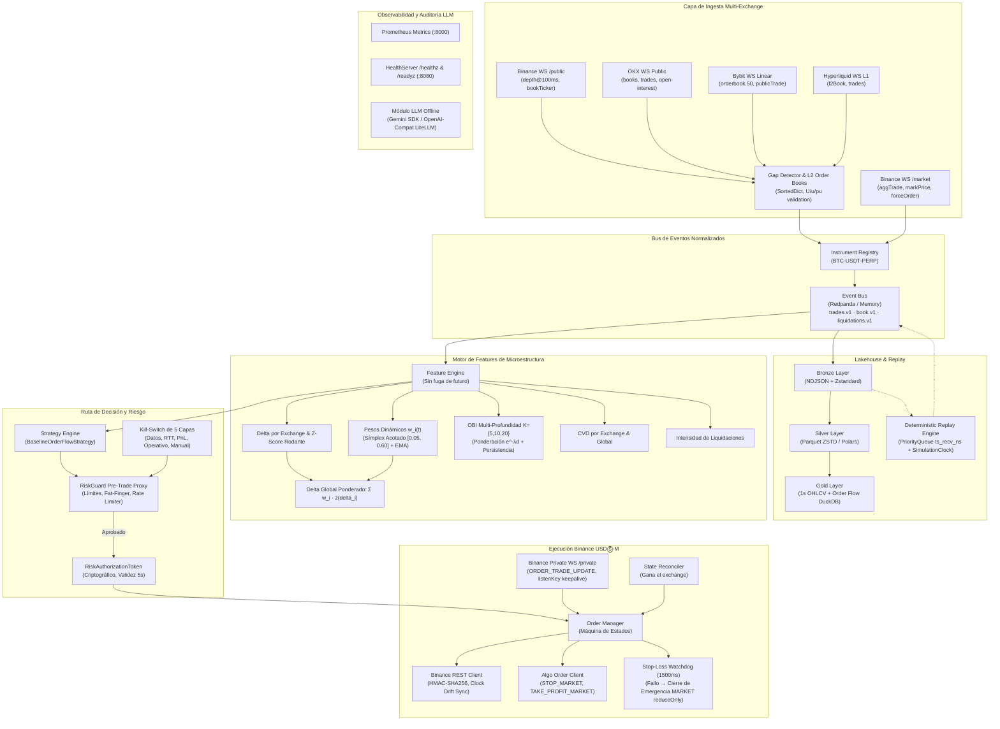

# Arquitectura del Sistema de Order Flow Multi-Exchange

## 1. Visión General de la Arquitectura
El sistema es una plataforma institucional de trading cuantitativo de baja latencia construida en Python 3.12 (`asyncio` + `uvloop`), diseñada bajo principios escépticos de microestructura de mercado, seguridad ineludible y reproducibilidad matemática:

---

## 2. Decisiones Clave de Diseño y Reglas Ineludibles

### Segregación Categórica de WebSockets de Binance
Tras la retirada definitiva de las URLs legacy `/ws` y `/stream` el 23 de abril de 2026, el sistema segrega estrictamente sus conexiones:
1. `wss://fstream.binance.com/public`: Exclusivo para streams de profundidad de libro (`depth@100ms`) y mejores cotizaciones (`bookTicker`).
2. `wss://fstream.binance.com/market`: Exclusivo para trades agregados (`aggTrade`), mark price (`markPrice@1s`) y liquidaciones forzadas (`forceOrder`).
3. `wss://fstream.binance.com/private`: Exclusivo para el User Data Stream con `listenKey` autenticado.

Cualquier intento de suscribir canales de mercado en la conexión `/public` o en `/private` es interceptado y bloqueado con error categórico `BinanceCategoryViolationError`.

### Órdenes Condicionales y Protección Atómica
1. **Rutas Oficiales**: Todas las órdenes condicionales (`STOP_MARKET`, `TAKE_PROFIT_MARKET`) se dirigen exclusivamente a `POST /fapi/v1/algoOrder`. El endpoint `/fapi/v1/order` devuelve el error `-4120 (STOP_ORDER_SWITCH_ALGO)` si se intentan enviar allí.
2. **Watchdog de Stop-Loss Innegociable**: Al confirmarse un fill de entrada, el `OrderManager` inicia un temporizador de 1500 ms para adjuntar la orden condicional en Binance. Si transcurren más de 1500 ms sin confirmación o el endpoint falla, se dispara la Capa 4 del Kill-Switch y se emite inmediatamente una orden a mercado con `reduceOnly=True` para cerrar la posición de inmediato.

### Proyección Acotada al Símplex en Pesos Dinámicos
Para evitar que un exchange domine el cálculo del Delta Global o que otro quede anulado, los pesos $w_i(t)$ se calculan mediante una proyección euclidiana sobre el símplex unitario $\sum w_i = 1.0$ con cotas estrictas $w_i \in [0.05, 0.60]$ resuelta por bisección monótona en tiempo $O(N \log \frac{1}{\epsilon})$.
